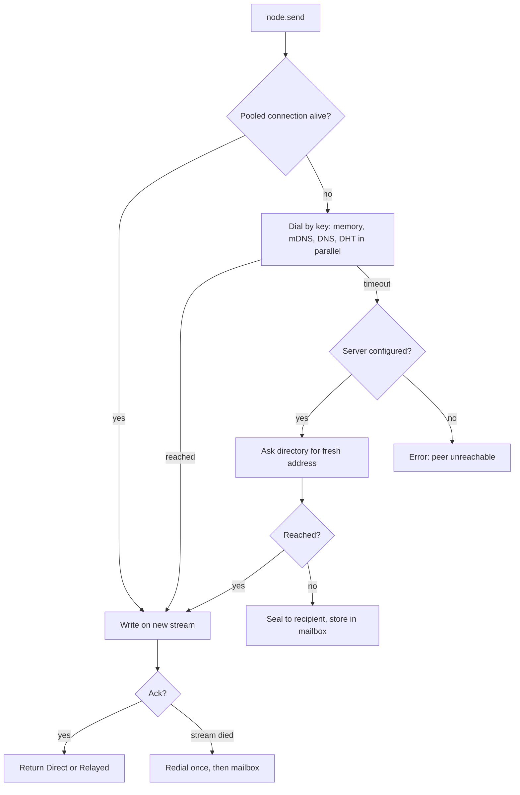

# Architecture

tethersys is one library with three rules:

1. **Every layer works alone.** No server, no relay, no internet: nodes still pair, talk, sync and share files on a LAN.
2. **Layers stack instead of competing.** All discovery methods run at once and the first good answer wins. All transports are paths of one connection, and the best path is used at every moment.
3. **Infrastructure never sees plaintext.** Relays forward ciphertext. The server stores sealed envelopes and content-addressed blobs it cannot alter.

## The stack

```
 ┌────────────────────────────────────────────────────────────────────────┐
 │  APP                                                                   │
 ├───────────┬───────────┬───────────┬───────────┬───────────┬────────────┤
 │ Messages  │ Request / │  Files    │  Topics   │  Spaces   │  Tunnels   │
 │ + mailbox │ response  │ (blobs)   │ (gossip)  │ (LWW sync)│ (WireGuard)│
 ├───────────┴───────────┴───────────┴───────────┴───────────┼────────────┤
 │  TRUST GATE  pinned keys · invites · per-space members     │ server hub │
 ├────────────────────────────────────────────────────────────┴────────────┤
 │  ONE QUIC ENDPOINT per device  (TLS 1.3, identity = Ed25519 public key) │
 ├──────────────────────────────┬──────────────────────────────────────────┤
 │  DISCOVERY (all in parallel) │  PATHS (best one carries traffic)        │
 │  invite / last address       │  LAN direct                              │
 │  mDNS (LAN)                  │  hole-punched UDP                        │
 │  n0 DNS (pkarr)              │  relay: public n0 and/or your own        │
 │  Mainline DHT                │                                          │
 │  tethersysd directory           │                                          │
 └──────────────────────────────┴──────────────────────────────────────────┘
```

Built on [iroh](https://iroh.computer) 1.3 (stable since 1.0), iroh-blobs, iroh-gossip and n0's mDNS and Mainline lookups.

## How a send is delivered



Inside one connection, iroh starts on whichever path answers first (often the relay) and migrates to a direct path once a hole punch succeeds. The app sees this as `Event::LinkChanged`. Reported direct hole-punch success is around 90% in production for iroh, versus about 70% for libp2p. The remaining cases (both sides behind symmetric NAT, UDP blocked) stay on the relay, which runs over HTTPS on port 443 and passes nearly every firewall.

## What each path costs

| Path | When it is used | Typical latency added | Who sees what |
|---|---|---|---|
| LAN direct | Same network | ~0 ms | Nothing leaves the LAN |
| Hole-punched UDP | Different networks, at least one NAT is punchable | ~0 ms over the raw internet route | ISPs see encrypted UDP |
| Relay | Punch failed or `hide_ip` is on | One extra hop; pick a relay near users | Relay sees sizes and timing, never content |
| Mailbox | Peer offline | Until the peer's next poll (30 s default) | Server sees recipient id and envelope size |
| WireGuard hub | Device-level traffic, any app | One hop through the server | Server routes packets (it is the tunnel endpoint) |

## Menu: profiles

Pick a profile, then override any field on `Config`.

| Profile | Discovery | Relays | Server | Use when |
|---|---|---|---|---|
| `Public` (default) | mDNS, n0 DNS, DHT | Public n0 | none | You want zero setup |
| `Hybrid(ticket)` | mDNS, n0 DNS, DHT | Public n0 + yours | yours | You want the most reach plus offline delivery |
| `SelfHosted(ticket)` | mDNS, DHT, your directory | Yours only | yours | No third-party services allowed |
| `Local` | mDNS | none | none | Air-gapped LAN, field kits, classrooms |
| `Sovereign` | mDNS, DHT | none | none | No servers of any kind; accepts that some NATs will fail |

## Menu: services

| Service | Call | Works without server | Server adds |
|---|---|---|---|
| Pairing | `invite()` / `join()` | yes | nothing |
| Messages | `send(peer, channel, bytes)` | yes, live only | offline delivery, sealed |
| Request/response | `on_request()` / `request()` | yes | nothing (live by nature) |
| Files | `send_file()` / `accept_file()` | yes, sender must be online | cached copy for 72 h |
| Topics | `topic(name).publish()` | yes | nothing |
| Spaces | `space(name).set/get()` | yes | nothing (peers reconcile on contact) |
| Tunnels | `tunnel()` | no | WireGuard hub with stable per-device IPs |
| Custom protocol | `Node::builder(cfg).protocol(alpn, h)` | yes | nothing |

Size guidance. Messages: up to 16 MiB each, but use files above ~1 MiB. Spaces: whole-map digests are exchanged, so stay under tens of thousands of keys per space; store large values as files and keep the hash in the space. Topics: gossip suits fan-out to dozens or hundreds of peers; for 1:1 use messages.

## Security model

| Threat | Defense |
|---|---|
| Impersonating a device | Address is the device's public key; TLS proves possession of the private key |
| Stranger connects to you | Trust gate rejects any key not pinned (pairing is the only open protocol) |
| Stolen invite | One-time secret, constant-time check, expiry and use count |
| Relay reads traffic | QUIC end to end; relays forward ciphertext |
| Server reads mail | Ephemeral X25519 + ChaCha20-Poly1305 to a dedicated box key; inner message signed by sender |
| Server forges mail | Ed25519 signature over recipient + message; unknown senders dropped |
| Forged gossip / sync writes | Every topic message and space entry is signed by its author and bound to its topic or space |
| Tampered file | BLAKE3 verified streaming rejects bad chunks on arrival |
| Path traversal in file names | Offer names reduced to a bare file name on both `/` and `\` |
| Unauthorized relay or server use | Network token on server and relay; only registered members get mail, cache or tunnels |
| WireGuard key theft | Device generates its WireGuard key locally; only the public key goes to the server |

Not covered: metadata at the server (who mails whom, when), traffic analysis at relays, and a compromised device (its keys are its identity; remove it with `remove_peer` on the others).

## The server, `tethersysd`

One small binary. It is itself a tethersys node, so every request is authenticated by key.

```
             ┌─────────────── VPS ───────────────┐
 phone ──┐   │  iroh-relay  :443 TCP  (token)    │
 laptop ─┼──►│  tethersysd     :47711 UDP           │
 PC ─────┘   │    directory · mailbox · cache    │
             │  wg tethersys0  :47712 UDP (optional)│
             └───────────────────────────────────┘
```

| Function | Detail |
|---|---|
| Directory | Members re-register on every address change; peers ask when DNS/DHT are stale |
| Mailbox | Up to 2000 envelopes and 1 MiB each per member, kept 14 days |
| File cache | Pulls a blob from the sender when the receiver is offline; expires after 72 h |
| WireGuard hub | Stable /32 per device in 10.77.0.0/24; leases renew, expire after 24 h, and are restored after a reboot |
| Relay | Official `iroh-relay` with Let's Encrypt and `shared_token` access |

State is one file plus a blob store, sized for a household, a team, or a fleet of a few hundred devices on a small VPS. Beyond that, move state to a database (the `State` type is the only thing to replace).

## Mobile notes

| Platform | Background behavior | What to do |
|---|---|---|
| iOS | Sockets suspend shortly after backgrounding | Rely on the mailbox; call `check_mailbox()` on push or app resume; use `Event::Server` to show status |
| Android | Doze defers network | Foreground service for long transfers; mailbox for everything else |
| Both | Network changes constantly | Nothing: QUIC migrates the connection, and the server loop re-registers on every address change |
| iOS 26 / Android | Wi-Fi Aware peer links | Gives a direct link with no network at all; it is a natural future transport (see Roadmap) |

## Roadmap ideas

- Wi-Fi Aware and Bluetooth LE as custom transports, through iroh's `unstable-custom-transports` hook.
- Push notification hook in `tethersysd`, so iOS apps wake when mail arrives.
- Automerge-backed space type for rich text and nested documents.
